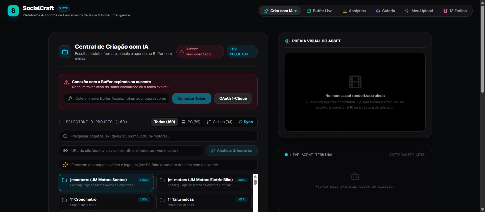

# 🎬 Teaser em Vídeo do Portfólio — Henrique Bezerra dos Santos

> Código programático de alta fidelidade desenvolvido com **Remotion (React + TypeScript)** para renderização de teaser profissional para **LinkedIn** e **GitHub**.

---

## 📐 Especificações Técnicas do Vídeo

| Formato | Resolução | FPS | Duração | Destino Ideal |
| :--- | :---: | :---: | :---: | :--- |
| **Landscape (16:9)** | 1920 × 1080 | 60 | 30s (1800 frames) | Post no LinkedIn, Destaques, YouTube, Twitter |
| **Square (1:1)** | 1080 × 1080 | 60 | 30s (1800 frames) | Feed LinkedIn, README do perfil no GitHub |

---

## 🚀 Como Executar e Renderizar

Certifique-se de estar dentro do diretório `video/`:

```bash
cd video
npm install
```

### 1. Pré-visualização Interativa (Remotion Studio)
```bash
npm run start
# Abre o Remotion Studio interativo em http://localhost:3000
```

### 2. Renderizar Vídeo em Alta Definição (.mp4)
```bash
npm run build
# Gera out/teaser-henrique-bezerra.mp4 (1080p, 60fps)
```

### 3. Renderizar Versão Quadrada para o Feed do LinkedIn (.mp4)
```bash
npm run build:square
# Gera out/teaser-linkedin-square.mp4 (1:1)
```

### 4. Gerar GIF Otimizado para o GitHub Profile README
```bash
npm run build:gif
# Gera out/teaser-github.gif
```

---

## 💼 Texto Pronto para Publicação no LinkedIn

Copie e cole este texto no seu próximo post do LinkedIn para acompanhar o vídeo teaser:

```markdown
🚀 De 0 a 45+ projetos entregues: como estruturei meu ecossistema de engenharia full-stack e IA.

Nos últimos meses foquei em resolver problemas práticos do mundo real, combinando arquitetura limpa, alta performance e inteligência artificial autônoma:

🔹 +45 Projetos completos em produção (micro-SaaS, PWAs de campo, ferramentas corporativas e CTF labs)
🔹 648 Contribuições reais no GitHub no último ano (@Henrique1601)
🔹 Rede Full-Mesh com 16 Agentes Especialistas de IA conectados via 26 servidores MCP e TypeSafe AI
🔹 PWAs Offline-First com IndexedDB e processamento client-side para vistorias técnicas

Confira o teaser do meu portfólio no vídeo acima e explore os projetos ao vivo:
🌐 Portfólio: https://henrique1601.github.io/Basic_Portfolio_/
🐙 GitHub: https://github.com/Henrique1601

Agradeço o feedback da comunidade tech! 🚀

#FullStack #ArtificialIntelligence #NextJS #React #WebDevelopment #TypeScript #SoftwareEngineering #Portfolio #OpenSource
```

---

## 🐙 Snippet para Inserir no seu GitHub Profile README (`Henrique1601/Henrique1601`)

```markdown
### 🎬 Portfólio Teaser & Highlights

<p align="center">
  <a href="https://henrique1601.github.io/Basic_Portfolio_/">
    
  </a>
</p>

<p align="center">
  <a href="https://henrique1601.github.io/Basic_Portfolio_/">
    <strong>🌐 Explorar Portfólio Completo Interativo (45+ Projetos) →</strong>
  </a>
</p>
```
